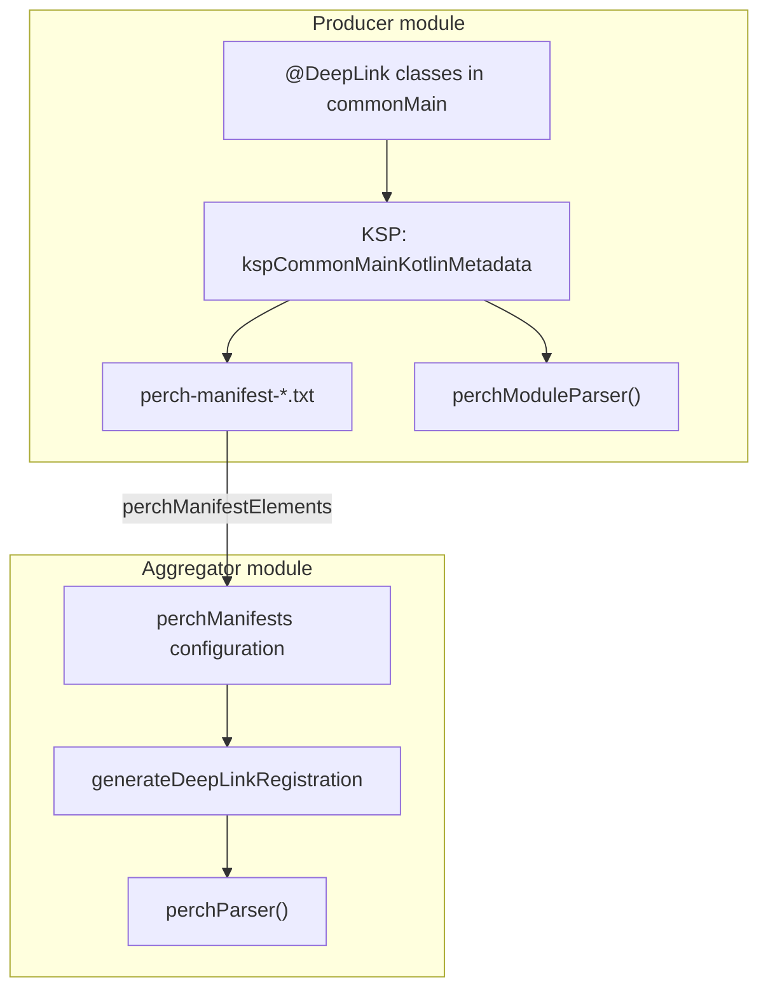

# Multi-module apps

In a modular app, each feature declares its own routes, and one module collects them. Perch uses two
Gradle plugins for this:

| Plugin | Apply it to | It generates |
| --- | --- | --- |
| `dev.carcara.perch` | Each module that declares routes. | A route manifest, and `internal fun perchModuleParser()`. |
| `dev.carcara.perch.aggregation` | The module that assembles the app. | `public fun perchParser()`. |

A module can apply one plugin, both plugins or no plugin.

## A typical layout

The [sample app](../sample.md) uses this layout:

```text
sample/
  sample-navigation/        SampleRoute, the supertype of all routes
  features/home/api/        producer: @DeepLink("/home")
  features/payments/api/    producer: /payments/{id} and /payment-approvals
  features/payments/impl/   the handler for the approvals link
  sample-di/                the router, and its interfaces for the platform apps
  sample-app/               aggregator: perchParser() for both features
  sample-android/           the Android app
  sample-ios-app/           the iOS app
```

Each feature `api` module applies the producer plugin. `sample-app` applies the aggregator plugin.
No central list names the routes. To add a feature, add a module.

## How the pipeline works



1. The producer plugin adds the Perch KSP processor to the `commonMain` metadata compilation.
2. The processor finds the `@DeepLink` classes in the module and checks them for collisions.
3. The processor writes a route manifest and `perchModuleParser()`.
4. The producer plugin publishes the manifest on the `perchManifestElements` configuration.
5. The aggregator plugin resolves the manifests of its `commonMain` dependencies.
6. The `generateDeepLinkRegistration` task checks all routes for collisions and writes
   `perchParser()` into `commonMain` of the aggregator module.

## The producer plugin

```kotlin title="features/payments/api/build.gradle.kts"
plugins {
    kotlin("multiplatform")
    kotlin("plugin.serialization")
    id("com.google.devtools.ksp")
    id("dev.carcara.perch")
}

kotlin {
    jvm()
    iosSimulatorArm64()

    sourceSets {
        commonMain.dependencies {
            api("dev.carcara.perch:perch-core:0.1.0")
        }
    }
}

perch {
    outputPackage.set("com.example.payments.api")
}
```

### Two targets or more

**A module that applies `dev.carcara.perch` must declare at least two Kotlin targets.** The
processor runs on the `commonMain` compilation, and Kotlin Multiplatform creates that compilation
only for two or more targets. With one target, the processor has no code to scan.

If a producer module has fewer than two targets, the build fails at configuration time. The message
names the module and its targets. The aggregator module does not have this rule.

### Contribute routes without a parser

If a feature module does not need its own parser, set `outputPackage` to an empty string. The
module then publishes its manifest, but it does not generate `perchModuleParser()`.

```kotlin
perch {
    outputPackage.set("")
}
```

## The aggregator plugin

```kotlin title="app/build.gradle.kts"
plugins {
    kotlin("multiplatform")
    id("dev.carcara.perch.aggregation")
}

kotlin {
    jvm()
    iosSimulatorArm64()

    sourceSets {
        commonMain.dependencies {
            api(project(":features:home:api"))
            api(project(":features:payments:api"))
        }
    }
}

perchAggregation {
    outputPackage.set("com.example.app")
}
```

The aggregator writes `PerchDeepLinkRegistration.kt`. The producer writes `DeepLinkRegistration.kt`.
The names are different, so one module can apply both plugins.

### Which dependencies the aggregator reads

The aggregator reads the same dependency graph that `commonMain` of its module compiles against.
Thus each route that it finds is a class that the module can reference.

- It reads `commonMain` dependencies declared with `implementation` or `api`.
- It reads a transitive dependency only through `api`. If module `A` depends on `B` with
  `implementation`, an aggregator that depends on `A` does not see the routes of `B`. Depend on `B`
  directly, or change `A` to use `api`.
- It does not read dependencies of platform source sets, such as `androidMain` or `iosMain`.
- It does not read `compileOnly` dependencies.

!!! warning "A route that the aggregator cannot see fails without an error"

    Declare each producer dependency in `commonMain`. If you declare it in a platform source set,
    the route is not in `perchParser()`, and `parse` returns `null` for its URLs.

    The generated registration is in `commonMain`. Code in `commonMain` cannot reference a class
    that only `androidMain` can see, so this rule is necessary.

After each run, the task logs what it found:

```text
Perch: generated perchParser() for com.example.app with 3 route(s) from 2 manifest(s):
```

If a route is not there, examine where the aggregator module declares the dependency on its
producer.

### Collisions between modules

The KSP processor sees one module at a time. Two features can each declare a pattern that is
correct in its own module, but that collides with the other. The aggregator finds this and stops the
build:

```text
Deep link collision between modules. 'com.example.a.PaymentLink' in :features:a declares 'payments/{id}', and 'com.example.b.PaymentLink' in :features:b declares 'payments/{code}'. A URL matching one matches the other, so the parser cannot know which route to return. The manifests are perch-manifest-features-a.txt and perch-manifest-features-b.txt; change one of the two patterns.
```

Change one of the two patterns.

## One module only

An app with all its routes in one module does not need the aggregator. Apply the producer plugin
and call `perchModuleParser()` from the same module. See
[Quick start](../get-started/quick-start.md#one-module-only).
