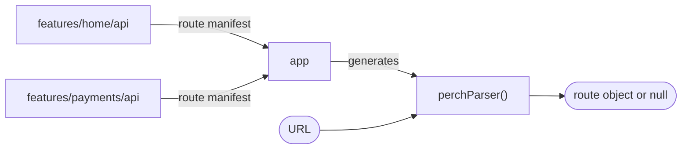

# Perch

Perch is a type-safe deep-link library for Kotlin Multiplatform. You annotate a class with
`@DeepLink`. Perch then generates the code that turns a URL into an instance of that class.

```kotlin
@DeepLink("/payments/{id}")
class PaymentLink(val id: String)

val parser = perchParser(schemes = setOf("myapp"))

parser.parse("myapp://payments/abc123") // PaymentLink(id = "abc123")
parser.parse("myapp://settings")        // null
```

Perch stops at the route object. Your app decides what to do with it: which screen to show, and
if the user can open that screen.

## How it works

Perch has one runtime library and two Gradle plugins:

- **`perch-core`** holds `@DeepLink` and `DeepLinkParser`. Your app calls the parser at runtime.
- **`dev.carcara.perch`** is the producer plugin. Apply it to each module that declares routes. It
  runs a KSP processor on the module and publishes a route manifest, which is a list of the routes
  that the processor found.
- **`dev.carcara.perch.aggregation`** is the aggregator plugin. Apply it to the module that
  assembles your app. It collects the route manifests of its dependencies and generates one
  `perchParser()` function.



## What Perch checks

- If two routes can match the same URL, the build fails. The KSP processor checks the routes of one
  module. The aggregator checks the routes of all modules together.
- If a parser accepts `http` or `https`, it must have a list of hosts. Without one, the constructor
  throws. See [Schemes and hosts](guides/schemes-and-hosts.md).
- If a producer module has fewer than two Kotlin targets, the build fails at configuration time. The
  message names the module.

## Platforms

`perch-core` is published for these targets:

| Platform | Targets |
| --- | --- |
| Android | `android`, minSdk 21 |
| JVM | `jvm` |
| iOS | `iosArm64`, `iosSimulatorArm64`, `iosX64` |
| macOS | `macosArm64`, `macosX64` |

The KSP processor and the Gradle plugins run inside Gradle, on JDK 21 or later.

## Next steps

- [Get started](get-started.md).
- [Run the sample app](sample.md).
